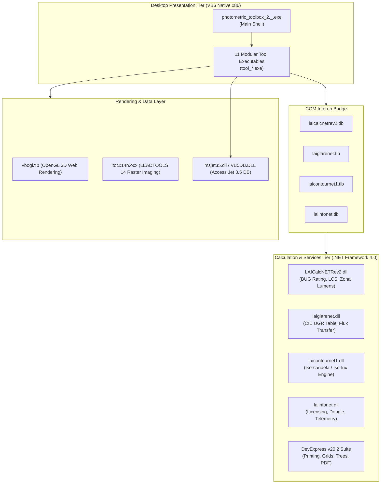

# Photometric Toolbox 2.14: Architecture & Component Specifications

## 1. System Overview

Photometric Toolbox 2.14 (Lighting Analysts, Inc.) is a specialized engineering application for analyzing, modifying, and reporting photometric lighting data files (IES LM-63, EULUMDAT, CIBSE TM14).

It uses a **multi-tier hybrid architecture**:
1. **Desktop Shell & Presentation Tier**: Native Visual Basic 6.0 (x86) utilizing ActiveX controls.
2. **Specialized Calculation Tier**: .NET Framework 4.0 managed assemblies exposed via COM Interop / Type Libraries (`.tlb`).
3. **Advanced Reporting & UI Controls**: DevExpress WinForms Suite v20.2.
4. **Data & Catalog Storage Tier**: Microsoft Jet 3.5 Database Engine (`msjet35.dll`, `VB5DB.DLL`).
5. **Graphics & 3D Visualization**: OpenGL via `vbogl.tlb` and LEADTOOLS Imaging v14.

---

## 2. Runtime Environment & Dependencies

| Dependency | Purpose | Target Version / Library |
| :--- | :--- | :--- |
| **VB6 Runtime** | Core language runtime for shell & tools | `MSVBVM60.DLL`, `VBA6.DLL`, `OLEAUT32.DLL` |
| **.NET Runtime** | Calculation engines & modern UI | `.NET Framework 4.0` (Installer checks for >= 4.6.1) |
| **DevExpress WinForms** | Advanced grid, report printing, tree list, PDF viewer | Version `20.2.6.0` |
| **ActiveX Controls** | Legacy grid, tab controls, toolbars | `tdbg7.ocx` (True DBGrid 7), `sstbars2.ocx`, `Tabctl32.ocx` |
| **Jet Database Engine** | Luminaire catalog search & data caching | `msjet35.dll`, `msjter35.dll`, `msjint35.dll`, `JETCOMP.exe` |
| **3D Rendering** | Polar solid / 3D web display | `vbogl.tlb` (Visual Basic OpenGL) |
| **Imaging Engine** | Exporting raster graphics & plots | `ltocx14n.ocx`, `ltimg14n.dll` (LEADTOOLS 14) |

---

## 3. Communication Model: VB6 to .NET Interop

The legacy VB6 applications communicate with the .NET calculation libraries through standard **COM Callable Wrappers (CCW)**:
* Each .NET assembly (`LAICalcNETRev2.dll`, `laiglarenet.dll`, `laicontournet1.dll`, `laiinfonet.dll`) has a corresponding pre-compiled COM Type Library (`.tlb`).
* The installer registers these assemblies in the Windows Registry (`HKEY_CLASSES_ROOT\CLSID`) with the `mscoree.dll` in-process server.
* When a VB6 tool creates a calculation object (e.g., `Set calc = New LAICalcNETRev2.LCSRatingType`), COM loads the CLR in-process, allowing seamless invocation of high-performance modern calculations.
