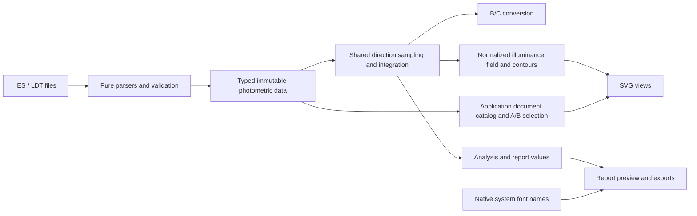

# Photometric core, vector views, and interface implementation plan

Status: **requested features implemented; verification recorded, with the direct-ratio export dependency and final native workflow still open**. See the [verification record](feature_verification.md) for evidence and limits. Baseline commit: `5d18755`. This plan supersedes the follow-up list after the completed ribbon redesign; that earlier checklist remains historical acceptance evidence.

The requested work is one coordinated update. The [core investigation](core_module_findings.md) establishes the math and format defects first. Only core modules were decompiled. Interface decisions below come from the current application and the user's requirements.

## Scope and acceptance map

| Request | Deliverable | Completion proof |
| --- | --- | --- |
| 1. Conversion flux loss | Type-aware integration and signed, coverage-aware B/C conversion in pure core modules | Analytic flux tests, directional landmarks, asymmetric round trips, convergence at 5°/2.5°/1°; no corrective intensity scaling |
| 2. LDT import | Standards-based LDT reader, repaired writer, common file dispatcher | Independent fixtures for all five symmetries; correct geometry/normalization; Open, Library, A, and B accept IES/LDT |
| 4. Bundle size | Measured, demand-loaded feature chunks and removal of unused framework/theme imports | Before/after size report, no >500 kB chunk warning, unchanged default view and working first activation of every tool |
| a. Interface icons | Existing `AppIcon` SVGs on tabs and primary commands | Consistent icon sizes, visible labels, decorative icons hidden from accessibility APIs, no duplicate accessible names |
| b. Vector 2D views | Preserve SVG polar/Cartesian/compare/report graphics; replace illuminance canvas with SVG contours | No raster canvas/image in any 2D plot; sharp zoom/print output, working hit tests, theme changes and resizing |
| c. Heavy illuminance | Cached normalized illuminance field and contour geometry using the shared sampler | Dense-file redraw measured against baseline; height/units/theme/pointer updates do not rebuild the field |
| d. Two comparison dropdowns | Independent, clearly labeled A and B source selectors backed by one document catalog | File/library/sample/current document work for either side; selected name, curves, metrics, and deltas update together |
| e. Themed dropdowns | One accessible themed selection component for interface and report controls | Both themes, keyboard/typeahead, popup placement, dismissal, focus restoration, and dialog interactions verified |
| f. System UI fonts | One interface typography policy, inherited by form controls and numeric displays | Computed styles agree across tabs, ribbon, inspector, tables, dialogs, and selectors at each scale |
| g. Report font selection | Actual installed font-family list in desktop Reports, independent report font preference | Selecting a real family changes paper, SVG labels, print/PDF, and exported HTML without changing interface fonts |

All checked implementation items describe the code now present; the verification record distinguishes automated proof from outstanding platform checks. The direct-ratio item is partial: imported ratios are preserved and missing ratios rejected; generation remains unimplemented.

Scope excludes decompiling/rebuilding legacy UI, CIBSE/EXL import, additional report templates, a catalog database, arbitrary fixture aiming controls, physical printer support, and unrelated calculations. Necessary fixes to type handling, invalid built-in fixtures, and LDT serialization are included because the requested features depend on them.

## Architecture and ownership

- `src/core/` owns angle conventions, symmetry, interpolation, conversion, numerical fields, format parsing, and serialization. No Vue, DOM, Three.js, Tauri, locale, or wall-clock dependency enters this layer.
- `PhotometricData` keeps the native angular grid and photometric type. Add optional typed EULUMDAT metadata for fields that cannot be represented by the existing IES-oriented structure; preserve source metadata instead of encoding assumptions into filenames.
- The shell/composables own the active document, an in-session catalog, two comparison selections, visualization settings, and report preferences. Store immutable photometric payloads with shallow reactivity so numerical loops do not traverse reactive proxies.
- Components receive data/settings and emit changes. Graphs consume core sampling or geometry results; converter and import components do not implement their own mathematics.
- Tauri supplies read-only system font enumeration. The frontend receives family names, not font file paths or bytes.
- `AppIcon` and one themed selection component are shared UI infrastructure. Reuse the installed PrimeVue Select in unstyled mode behind one wrapper, with the existing CSS tokens; remove the unused full Aura theme. Report font settings apply only to paper content and report exports.

Proposed file boundaries, kept small enough to review independently:

| Layer | Files/change |
| --- | --- |
| Core | `photometricSampling.ts`, `goniometerConversion.ts`, `illuminance.ts`; extend `calculations.ts` with explicit type handling |
| Formats | Extend `eulumdatConverter.ts` to reader/writer; add `photometricParser.ts` as the single import dispatcher; extend `types.ts` metadata |
| State | App-owned `useLuminaireCatalog.ts` and report preferences; remove comparison's local fallback data ownership |
| UI | `ThemedSelect.vue`, existing `AppIcon.vue`, `App.vue`, shared CSS, affected dialogs |
| Plots | Replace `IsoIlluminanceViewer.vue` raster rendering; adapt existing SVG and 3D direction consumers where Type B handling requires it |
| Reports/native | `ReportViewer.vue`, `systemFonts.ts`, Rust font command and its declared capability |
| Build/tests | `main.ts`, dependency manifests, targeted asynchronous component imports, numerical and UI regression checks |

These are responsibility boundaries, not a requirement to create an abstraction per function. No generic plugin system or new global state library is needed.

## Phase 0 — evidence and fixtures

- [x] Inspect only legacy core libraries and retain artifact identities, method tokens, findings, and coverage limits.
- [x] Reproduce 3,653 → 1,205 lm and isolate the Type B integration mismatch without rescaling candela.
- [x] Record actual illuminance timings, rendering type, font mismatch, comparison ownership, and the current bundle warning.
- [x] Add independent synthetic numerical fixtures and hand-authored LDT fixtures for the changed core behavior. Clearly identify the existing invalid Type B sample and preset as repair inputs, not valid regression oracles.
- [x] Record the existing production output: main JavaScript 835,162 bytes (219,268 gzip), CSS 57,483 bytes (9,583 gzip); all components are statically imported. Isolated minified esbuild probes measured PrimeVue config/Aura at about 158 KiB, Select including its bundled dependencies at 199 KiB, and representative Three.js imports at 463 KiB. These probes overlap shared code and must not be added together as an application-size prediction.

Do not rely on the old documentation's “fully implemented” labels or on writer→reader round trips alone. Existing numeric snapshots are change detectors; analytic correctness takes precedence when a diagnosed defect changes a result.

## Phase 1 — directional core and conversion

Dependencies: Phase 0 fixtures. This phase is the prerequisite for Type B LDT export, physically correct illuminance, and consistent Type B plots/reports.

- [x] Define and document Type C and signed Type B direction transforms, axis conventions, forward coverage, and symmetry. Include cardinal/asymmetric landmark tests before connecting any viewer.
- [x] Build one immutable directional sampler: binary-search angular bracketing, bilinear interpolation, Type C 0–90° / 0–180° / 90–270° symmetry and periodic seam, signed Type B axes, and zero outside measured/representable angular support. Include the native IES C90–C270 reflection case independently of LDT Isym 3 reconstruction. Reflect B axes only when their stored grid declares the corresponding symmetry.
- [x] Define pole consistency: C γ0/180 and B H±90 each identify the same physical ray across the other angular coordinate. Keep raw records unchanged; reconcile only small differences within an explicitly tested roundoff tolerance in the derived sampler, and reject materially conflicting pole data with a useful error. Conversion output emits consistent poles.
- [x] Give calculation entry points an explicit photometric type. Use Type C and Type B solid-angle measures correctly, and angular-span weights for nonuniform grids and duplicated 0°/360° endpoints. Update parsers, editors, generators, converter, and report consumers together.
- [x] Derive zonal and directional analyses consistently from physical directions. Do not feed raw signed B coordinates into C-only BUG/CU or plotting code. Keep source-coordinate peak angle labels identifiable.
- [x] Move conversion from the modal into the pure core. Use full signed target B grids and full-circle C grids unless a proven symmetry reduction is deliberately requested. Preserve multiplier application exactly once and avoid arbitrary per-sample rounding.
- [x] Handle same-type conversion without changing data. Unsupported Type A must never silently use Type C mathematics in analysis, plots, illuminance, conversion, or LDT export. Until its mapping is separately validated, reject those operations/import-to-analysis with an explicit unsupported-type message and preserve the existing active document. Any raw read/save path must preserve its original type and records.
- [x] Show source/output flux and sampling resolution in the converter. For C sources with uplight outside B coverage, show the excluded component explicitly before Apply/Save; do not claim total-flux preservation or silently compensate it with brighter candela.
- [x] Repair the invalid flood sample and generator: either generate genuine signed Type B data or correctly identify a C distribution. Keep metadata accurate and give the flood preset a validated physical beam model.
- [x] Correct legacy attribution and misleading integration descriptions in the relevant comments/docs.

Acceptance:

- Constant Type C sphere: `4πI`; uniform downward hemisphere and full signed B hemisphere: `2πI`.
- Downward cosine and cosine-power sources: `πI0` and `2πI0/(n+1)`; a 3,600 lm source converges toward 3,600, rather than being forced to match the old approximate 3,653 result.
- Initial conversion error budgets: ≤2% at 5° and ≤1% at 2.5°/1° for smooth representative fixtures; document observed convergence and tighten the thresholds where justified. Sharp cutoffs have separate sampling tests rather than a false universal guarantee.
- Signed landmark transforms round-trip within floating-point tolerance. Asymmetric sources preserve their quadrants and directional intensities within interpolation tolerance. Include native IES C90–C270 symmetry, pole consistency, and unsupported Type A rejection cases.
- Zonal flux sums agree with total flux; nonuniform/closure grids do not change integrated energy; save/reopen preserves photometric type and signed axes.

## Phase 2 — LDT reader and writer as one feature

Dependencies: typed sampler/conversion and corrected integration from Phase 1. Add input dispatch once and use it in every file-entry route.

- [x] Implement strict `parseEULUMDAT` with correct fixed header records, all six luminous-area dimensions, finite and bounded counts, ordered angle arrays, all lamp-set records, conversion factor, direct ratios, and descriptive errors. Keep raw metadata where the current active model uses only the first lamp set.
- [x] Read the full `Mc` angular grid separately from the reduced stored intensity planes. Reconstruct Isym 0–4 into physically oriented Type C data, including the C270→C0→C90 Isym 3 sequence and any required closure.
- [x] Apply cd/klm normalization and conversion factors once. Preserve negative-count absolute photometry semantics and avoid confusing lamp lumens with luminaire lumens.
- [x] Add `parsePhotometric(content, filename)` dispatch; route native/browser Open, comparison A and B, Library imports, and samples through the appropriate common reader. Accept uppercase extensions and give content/extension mismatch errors without replacing current data.
- [x] Repair the writer's missing geometry records, full-grid counts, normalization, absolute-photometry sign, and extension handling. Convert Type B through the validated Type C path before LDT serialization.
- [x] Initially emit explicit Isym 0 data for non-axisymmetric distributions to avoid inferring unsupported symmetry from an array endpoint. Preserve appropriate axisymmetric output only when its count rules are verified.
- [ ] Preserve supplied direct ratios. Replace fabricated direct ratios with a documented and verified calculation for the required room indices; validating that method is a prerequisite for marking export complete. Core inspection found an IES zonal DR function for one RCR, but no EULUMDAT ten-room-index generator or missing-value sentinel. A geometrical `RCR = 5/k` substitution alone is not sufficient validation. Resolve this using a standards-backed definition and independent cases; until then reject export that lacks required direct ratios with a precise explanation rather than emitting invented values or zeros as “unknown.”
- [x] Use source date/metadata or a deterministic empty/default field where the format permits it; do not insert the current date in pure serialization.
- [x] Reject the old malformed toolbox LDT layout with an actionable message rather than guessing shifted fields. Do not rewrite or delete any existing file on import. Saving imported LDT as IES uses an `.ies` name, and exporting it again uses a single `.ldt` suffix.

Acceptance:

- Independent fixtures for all symmetries, nonuniform grids, multiple lamp sets, relative/absolute normalization, conversion factors, four different area heights, metres/feet export, and pole/closure handling.
- Reject truncated records, invalid counts, nonfinite/negative intensity data, invalid axes, and impossible normalization with a useful error; keep the prior active document and comparison selection on failure/cancel.
- Test direction samples, flux, geometry, and metadata against independent expectations. Test IES→LDT and B→C→LDT, not merely output-text equality with our writer.
- Validate at least one manufacturer-supplied fixture with its provenance retained. Manufacturer interoperability was checked with two independently downloaded SPX/LEDiL files; provenance and hashes are retained in the verification record.

## Phase 3 — shared interface controls and typography

Can begin after the plan is established; land before the comparison and report-font UI so those features reuse it.

- [x] Add one token-based themed selection wrapper around the installed PrimeVue Select, in unstyled mode, for ribbon, dialogs, library sort, and reports. Reuse its keyboard, filtering, and overlay behavior; style its pass-through sections with the existing tokens. Remove Aura registration and its unused theme dependency. Do not implement a second custom keyboard/listbox engine.
- [x] Give it explicit value/option/disabled contracts and accessible labels. Support arrows, Home/End, Enter/Space, Escape, Tab, typeahead, and search for long font/catalog lists. Keep selected value separate from the highlighted option until selection commits.
- [x] Position its popup within the visible viewport at 130% scale, including near the bottom of a dialog. If the overlay is teleported, include it in focus containment and outside-click/Escape handling. Close and remove listeners/observers on unmount.
- [x] Use `system-ui` consistently for interface text and explicitly inherit font family on buttons, inputs, selects, textareas, summaries, and table controls. Replace interface monospace overrides with system-family text and tabular numerals where alignment is useful. Leave report paper under its own font policy.
- [x] Reuse `AppIcon` for the five tabs and primary File/Analyze/Display actions. Use a consistent small icon size plus a text caption; hide decorative SVGs from assistive technology. Retain text labels in overflow menus and at the minimum window size.

Acceptance: one selected state per control, complete keyboard operation, visible focus, no popup clipping, consistent computed font families, both themes, and no reduced workspace usability at 900 × 600 / 130%.

## Phase 4 — independent comparison A and B

Dependencies: common parser, shared selectors, app-owned immutable data.

- [x] Promote the currently dialog-local catalog into one app-owned in-session collection. Seed samples once; register imports from File, Library, and either comparison slot. Use stable IDs rather than filenames, since two different files can have the same name.
- [x] Store `selectionA` and `selectionB` independently. Each has a named current-document option and catalog entries. Default A to the active document and B to the roadway sample. A slot explicitly linked to “Current document” follows edits; a selected catalog document stays selected.
- [x] Render two labeled themed selectors, A and B, with accessible Open file/Library actions for the targeted side. Source chooser actions must not accidentally become the selected luminaire or clear the previous value when cancelled.
- [x] Selecting a source for comparison does not replace the editing workspace's active document. The existing Library Compare action sets B and opens Compare; any chooser opened for A targets A. Preserve selections across tab changes and library close/reopen.
- [x] Make `LuminaireCompare.vue` a consumer of exactly two supplied documents. Remove its local sample fallback and duplicate parsing. Filenames, SVG curves, colors, metrics, and deltas derive from those same documents and update in one render.
- [x] Use the shared type-aware direction sampling for Type B and asymmetric opposite planes. Support identical A/B selections without errors or misleading deltas.

Acceptance: test both slots independently with file, library, and sample choices, same-name files, cancellation/invalid imports, linked active edits, tab switches, and identical fixtures. Verify both selectors and both full names remain reachable at the minimum layout; long names may truncate visually with an accessible full label.

## Phase 5 — vector 2D views and fast illuminance

Dependencies: shared directional sampler and immutable document state. Existing polar, Cartesian, comparison, report, and catalog curves are already SVG; keep that rendering rather than rebuilding it as canvas.

- [x] Add a pure normalized illuminance field over MH-space using `E = I(direction) cos³θ / h²`, with unit/height scaling separated from the spatial field. Use the same interpolated sampler as conversion and analysis, including Type B physical directions.
- [x] Compute a bounded grid once per source/distribution change, initially around 121 × 121 points rather than 90,000 pixel samples. Verify spatial convergence against a finer reference before fixing the final resolution.
- [x] Extract interpolated isolines/filled bands from this grid and render them as SVG paths with SVG axes, MH grid, labels, and legend. The legacy core establishes the grid→segment boundary; use a small tested contour implementation with explicit saddle/edge/hole handling, not a per-pixel SVG rectangle replacement.
- [x] Use [`d3-contour`](https://d3js.org/d3-contour/contour) for contour extraction, with a small pure adapter returning numeric polygons/paths, and generate SVG path data without bringing in all of D3 or another plotting framework. Validate holes, disconnected regions, saddle cells, constant fields, and edge closure through independent fixtures. Measure this focused dependency in the final bundle report.
- [x] Cache normalized numeric fields and contour geometry by immutable source revision and spatial settings. Mounting height, fc/lux, theme, resize, UI scale, and cursor motion must reuse them. Rescale levels/labels without repeating angular lookups.
- [x] Keep the cursor readout local and lightweight, with at most one update per animation frame. Convert pointer coordinates through the SVG viewBox and evaluate/interpolate one point rather than rerendering the field. Cancel pending work on unmount; ignore obsolete results when files change quickly.
- [x] Bound geometry size, use non-scaling strokes where appropriate, and retain accessible descriptions/values. Ensure the peak/legend represents the actual plotted field; do not call nadir intensity the maximum for an asymmetric fixture.
- [x] Test other 2D SVG views with large grids and asymmetric/B data. Share type-aware sampling without changing zoom/Fit or view-setting persistence.

Acceptance:

- SVG only for 2D plot geometry; no `<canvas>`, embedded bitmap, or one rectangle per heatmap pixel.
- Analytic inverse-square, cosine, symmetry, uniform-source, zero-source, and fc/lux conversion tests; grid/contour accuracy against an independent fine reference.
- On the recorded machine and dense 181 × 73 input, target at least a 10× improvement from the 2,720 ms heatmap baseline and no >100 ms main-thread redraw during steady height/unit/theme changes. Record warmed medians and worst cases. If a cold field build still blocks noticeably, move that pure computation into a worker before closing the task; do not hide it with a spinner alone.
- Resizing and unit changes do not increment the field-build counter; repeated tab/file switches do not leak listeners, cached documents, or scheduled frames.

## Phase 6 — report fonts from the installed system list

Dependencies: shared themed selector, isolated report typography, native capability declaration.

- [x] Add a read-only `list_system_font_families` native command, run off the UI thread and cached for the app session. Use a platform font database library such as [font-kit's system source](https://github.com/servo/font-kit/blob/main/src/source.rs), rather than hard-coding a list or shelling out to platform commands from the frontend. Return sorted, deduplicated family names only.
- [x] Add the command's explicit Tauri permission/capability and a narrow frontend wrapper. Handle empty/error results with “System default” and visible feedback; font discovery must not block application startup or mathematical calculations.
- [x] For the browser development build, offer an explicit “Load system fonts” action using [Local Font Access](https://wicg.github.io/local-font-access/) when supported. Browser permission denial/unavailability must preserve a clearly labeled generic fallback; do not present guessed font names as an enumerated installed list.
- [x] Add a searchable Report Font selector next to Report Type. Default to System default, retain the selected family across report/view changes, and keep it independent of the UI system-font token. No additional report design/size controls are required by this scope.
- [x] Apply the family to paper text, tables, headings, and report SVG labels. Share the same font-family value with HTML export and print; quote/escape names safely in CSS/HTML. Wait for required fonts before printing and recheck pagination after a family change.
- [x] Export standalone HTML with the selected family and a generic fallback. The recipient needs that local family to reproduce it exactly; font files are not bundled or uploaded. Validate printed PDF font use separately from HTML CSS serialization.

Acceptance: an actually installed family can be selected in the desktop app and is used by all three report types and exports. Test long/Unicode family names, unavailable saved preferences, native discovery failure, browser permission denial, and interface typography remaining unchanged.

## Phase 7 — bundle and loading performance

Measure after the features above are connected so the result includes the real dropdown, contour, and font UI costs.

- [x] Inspect production output and dependency use. Keep PrimeVue configuration/Select, which now serve a requested feature; remove unused Aura/theme registration and dependencies. Import only the focused contour module, never a D3 umbrella package.
- [x] Split Three.js/3D, reports, comparison, conversion, and large dialogs at meaningful feature boundaries with `defineAsyncComponent`/dynamic imports. Keep loading/error states and settings in the shell. Load pure format parsers when needed if their measured size warrants it.
- [x] Preserve Visualize/3D as the default view. Its chunk is still needed at startup; describe reductions in shell size separately from total bytes needed by the default 3D workflow.
- [x] Avoid splitting the same core modules into duplicate copies or fetching a chunk on every tab switch. Verify unmount cleanup for scenes, workers, observers, listeners, and dropdown overlays.
- [x] Keep the current warning threshold. Remove the size warning through real tree shaking and feature boundaries, rather than raising `chunkSizeWarningLimit` or disguising an unchanged monolith with manual chunk names.

Acceptance: no output chunk over the existing 500 kB warning threshold; report minified and gzip sizes before/after and bytes requested for startup versus first tool activation. Native/offline production loading, first opens, repeat opens, and failed chunk loading must remain usable.

## Integration and delivery order

1. Add core fixtures and contracts.
2. Land sampling, type-aware integration, and conversion as one reviewable correctness change, including invalid sample/preset fixes.
3. Land LDT reader/writer and shared import dispatch with independent format tests.
4. Land shared themed controls, icons, and interface font inheritance.
5. Connect the shared catalog and both comparison selectors.
6. Replace illuminance rasterization with cached vector contours and record measurements.
7. Connect native font enumeration and report-font propagation.
8. Finish feature chunking against the final dependency graph, then run the complete workflow matrix.

Independent preparation may proceed in parallel, but later features must consume these shared contracts. Do not create one sampler per viewer, one parser per import route, a second comparison catalog, or another font policy in an export template.

## Final verification and stop condition

- [x] Pure-core analytic tests and independent LDT fixtures pass; errors/cancellation preserve existing documents.
- [x] `npm test`, `npm run build`, `cargo check`, and `git diff --check` pass. Add meaningful tests for mathematical/format/state regressions, not tests that merely mirror markup.
- [x] Check 1400 × 900 and 900 × 600, dark/light, 100%/130%; include popup placement, font search, both comparison slots, vector contours, and all dialogs.
- [ ] Run a keyboard-only native workflow: import LDT, choose Cartesian/plane, compare independently selected A/B, change report family, and save a PDF. Also reopen exported IES/LDT and standalone HTML.
- [x] Render PDFs and inspect graphs, fonts, tables, margins, page breaks, and absence of application controls.
- [x] Retain before/after performance and bundle measurements, fixture provenance, changed numerical expectations, and remaining platform limits. Update existing documentation where earlier parity claims were disproven.

Stop when every requested item in the scope table has its proof. Do not turn this into a general photometric-engine rewrite, a legacy UI reconstruction, or a theme redesign. Any unresolved format or formula question must be recorded as a concrete dependency before its implementation step is considered complete.
